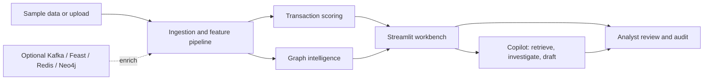

# 🛡️ FraudGuard AI

### Explore transaction risk. Trace connected entities. Keep analysts in control.

FraudGuard AI is an interactive fraud detection and investigation workbench built with Streamlit. Explore transaction patterns, score risk, investigate graph signals, and prepare analyst-reviewed SAR drafts from one dashboard.

<p align="center">
  <a href="https://frauddetectionproject-ejx7okwuu6c8nrszvyzhhv.streamlit.app"><strong>🚀 Open the live dashboard</strong></a>
  &nbsp; · &nbsp; <a href="#-get-started">Run locally</a>
  &nbsp; · &nbsp; <a href="ARCHITECTURE.md">Architecture</a>
</p>

<p align="center">
  <a href="https://frauddetectionproject-ejx7okwuu6c8nrszvyzhhv.streamlit.app"></a>
  <a href="https://github.com/SumedhPatil1507/fraud_detection_project/actions/workflows/ci.yml"></a>
  
  <a href="LICENSE"></a>
</p>

---

## 🧭 Explore this project

<p align="center">
  <a href="#-get-started">Get started</a> ·
  <a href="#-inside-the-workbench">Workbench</a> ·
  <a href="#-how-it-fits-together">How it fits together</a> ·
  <a href="#-optional-data-and-ai-pipelines">Pipelines</a> ·
  <a href="#-configuration">Configuration</a> ·
  <a href="#-project-map">Project map</a>
</p>

<details open>
<summary><strong>⚡ Quick start</strong></summary>

```bash
git clone https://github.com/SumedhPatil1507/fraud_detection_project.git
cd fraud_detection_project
python -m venv .venv
# Windows: .venv\Scripts\Activate.ps1
# macOS/Linux: source .venv/bin/activate
python -m pip install --upgrade pip
python -m pip install -r requirements.txt
streamlit run app.py
```

Open **http://localhost:8501**. The dashboard loads the included sample data automatically; no credentials or external services are needed to explore it.
</details>

## ✨ Inside the workbench

| Workspace | Explore |
|---|---|
| **Explorer** | Filter transactions by class and hour; inspect distributions, channels, correlations, and matching rows. |
| **Train and Metrics** | Train the ensemble and explore ROC/PR curves, confusion matrices, threshold behavior, and cost. |
| **Explainability and Drift** | Inspect feature drivers, SHAP views, and feature drift. |
| **Predict and Live Stream** | Score individual or simulated transactions and watch risk change. |
| **HITL, Audit, and SAR** | Review queued cases, prediction history, and SAR records. |
| **Graph Intel and Streaming & GNN** | Explore fraud-ring signals, entity relationships, service configuration, and evaluation results. |
| **Vault, Savings, Observability, and Compliance** | Review key-management tools, business impact, runtime metrics, and control checks. |
| **Copilot** | Retrieve precedents, inspect graph and SHAP signals, and draft a SAR for analyst review. |

**Make the charts your own:** Plotly visualizations support hover details, zoom, pan, selection, and legend toggles. The dashboard uses a shared dark theme. PII masking is enabled by default; uploaded files can be CSV, Excel, JSON, or Parquet and must include a binary `label` column.

> **Analyst-led by design:** Copilot drafts are checked for grounding and citations, and unverified drafts are withheld for review. SARs are never auto-filed.

## 🗺️ How it fits together



The dashboard can be explored on its own. Optional integrations add event-time features, streaming ingestion, graph persistence, or investigation assistance when configured. See [ARCHITECTURE.md](ARCHITECTURE.md) for more detail.

## 🧪 Get started

<details>
<summary><strong>Deploy the dashboard on Streamlit Community Cloud</strong></summary>

1. Push the repository to GitHub.
2. Create an app in Streamlit Community Cloud using this repository, branch `main`, and entry point `app.py`.
3. Select Python 3.12 in Advanced settings. Add optional secrets such as `GROQ_API_KEY` using Streamlit's Secrets settings.

If an existing app was created with Python 3.14, changing the repository will not change its interpreter. Redeploy it with Python 3.12; see [Streamlit's Python version guidance](https://docs.streamlit.io/deploy/streamlit-community-cloud/manage-your-app/upgrade-python).
</details>

<details>
<summary><strong>Run the dashboard in Docker</strong></summary>

```bash
docker build -f Dockerfile.streamlit -t fraudguard-streamlit .
docker run --rm -p 8501:8501 fraudguard-streamlit
```
</details>

<details>
<summary><strong>Start the optional FastAPI service</strong></summary>

```bash
uvicorn api:app --reload --port 8000
```

Interactive API docs: **http://localhost:8000/docs**. Docker assets for the API are also included.
</details>

## 🔌 Optional data and AI pipelines

These integrations are optional for the sample-data dashboard. Their configuration and service credentials are only needed when using the corresponding pipeline.

<details>
<summary><strong>Feast event-time features</strong></summary>

`feature_store.yaml` configures the local Feast registry, offline file source, and Redis online store. `feature_definitions.py` defines customer and merchant entities and rolling transaction/cross-channel views. Source rows need `event_timestamp` and `created_timestamp` for point-in-time retrieval.

```bash
feast -c . apply
```

The offline source defaults to `data/transaction_features.parquet`; populate it before historical retrieval.
</details>

<details>
<summary><strong>Kafka and Flink streaming</strong></summary>

The async Kafka consumer reads `financial.transactions.v1`, validates event identity and time, writes audit records to PostgreSQL and rolling features to Redis, then commits offsets after both writes succeed. Configure `KAFKA_BOOTSTRAP_SERVERS`, `DATABASE_URL`, and `REDIS_URL` and run:

```bash
python -m src.streaming.kafka_consumer
```

The optional PyFlink job computes customer features from a trailing 10-second event-time window and updates Redis. Install its dependencies with `pip install -r requirements-flink.txt`; the Flink cluster also needs the matching Kafka connector JAR.

```bash
python -m src.streaming.flink_fraud_processor
```

The default topic is `financial.transactions.v1`; the consumer group is `fraudguard-feature-pipeline`. Flink also accepts `KAFKA_GROUP_ID`, `FLINK_PARALLELISM`, and `FLINK_MAX_OUT_OF_ORDERNESS_SECONDS`.
</details>

<details>
<summary><strong>Heterogeneous graph fraud model</strong></summary>

The optional two-layer R-GCN models customer, merchant, device, and IP nodes and their relationships. It predicts transaction fraud, return-to-origin (RTO) probability, and node collusion risk. To supervise the RTO head, include a `fraud_type` value such as `rto`, `rto_fraud`, `return_to_origin`, or `return_to_origin_fraud`.

```bash
python scripts/train_gnn_fraud.py data/transactions.csv --epochs 40
```

Provide labeled transactions with customer and merchant IDs and optional device/IP columns. Weights default to `outputs/gnn_fraud.pt`. Neo4j output is used when a backend is configured.
</details>

<details>
<summary><strong>Fraud Investigation Copilot and SAR guardrails</strong></summary>

The LangGraph pipeline retrieves precedent chunks, gathers graph/SHAP signals, and drafts a SAR narrative. Guardrails require citations to retrieved chunk IDs and lexical support from cited context. Unverified drafts are withheld for mandatory analyst review.

For production writer validation, FinCEN deadline checks require `initial_detection_at`. RBI checks require `suspicion_concluded_at`, a holiday calendar, and `principal_officer_reason`. Set `RBI_HOLIDAY_CALENDAR` to newline-delimited `YYYY-MM-DD` dates. The FinCEN narrative limit is 20,000 characters. The optional Lerner cap applies when a `pricing` object includes `proposed_price` and `marginal_cost`; `LERNER_INDEX_MAX` defaults to `0.30` and can be overridden per pricing object.

OpenTelemetry spans wrap agent nodes, retrieval, graph/SHAP tools, GNN lookups, and evaluation steps. Set `OTEL_EXPORTER_OTLP_ENDPOINT` or `OTEL_EXPORTER_OTLP_TRACES_ENDPOINT` to export traces. Spans omit transaction text, customer identifiers, and retrieved document content.
</details>

<details>
<summary><strong>RAGAS audit evaluation</strong></summary>

The evaluation suite generates 50 repeatable synthetic SAR scenarios and reports Context Precision, Context Recall, Faithfulness, and Answer Relevancy. It requires `OPENAI_API_KEY` for evaluation and embeddings and `GROQ_API_KEY` for Copilot answers.

```bash
python -m eval.ragas_suite --output outputs/ragas_audit_report.json
```

The Streaming & GNN dashboard tab reads the report and plots aggregate and per-scenario metrics. `outputs/` is git-ignored because it contains generated artifacts and audit data.
</details>

## ⚙️ Configuration

`requirements.txt` installs the dashboard runtime. Optional Copilot/vector, GNN, Feast, streaming, and API dependencies are in `requirements-full.txt`; the dashboard falls back when optional integrations are unavailable. The Render API service installs the full dependency file from `render.yaml`.

| Variable | Purpose |
|---|---|
| `GROQ_API_KEY` | Writer LLM key for Copilot |
| `COPILOT_LLM_MODEL` | Copilot writer model |
| `CHROMA_PERSIST_DIR` | ChromaDB path (default `outputs/chroma_db`) |
| `COPILOT_TOP_K` | Number of precedent chunks retrieved |
| `SAR_JURISDICTION` | Default SAR jurisdiction (`US` or `RBI`/India) |
| `RBI_HOLIDAY_CALENDAR` | Newline-delimited holiday dates for RBI due-date checks |
| `LERNER_INDEX_MAX` | Maximum Lerner index (default `0.30`) |
| `OTEL_EXPORTER_OTLP_ENDPOINT` | Optional OpenTelemetry collector endpoint |

Configure service URLs as needed for PostgreSQL, Redis, Kafka, Neo4j, or object storage. Keep credentials in environment variables or your hosting platform's secrets manager.

## 🧰 Project map

| Path | Role |
|---|---|
| [`app.py`](app.py) | Streamlit dashboard |
| [`api.py`](api.py) | FastAPI service |
| [`src/pipeline.py`](src/pipeline.py) | Ingestion and feature pipeline |
| [`src/graph_intelligence.py`](src/graph_intelligence.py) | Graph risk intelligence |
| [`src/streaming/kafka_consumer.py`](src/streaming/kafka_consumer.py) | Kafka audit/cache consumer |
| [`feature_store.yaml`](feature_store.yaml) · [`feature_definitions.py`](feature_definitions.py) | Feast store and event-time feature views |
| [`src/models/gnn_fraud.py`](src/models/gnn_fraud.py) · [`scripts/train_gnn_fraud.py`](scripts/train_gnn_fraud.py) | R-GCN model and training CLI |
| [`src/agent_graph.py`](src/agent_graph.py) · [`src/copilot_guardrails.py`](src/copilot_guardrails.py) | Investigation Copilot and SAR checks |
| [`eval/ragas_suite.py`](eval/ragas_suite.py) | RAGAS scenario evaluation |
| [`tests/`](tests/) | Unit and integration tests |

## 🧪 Tests

```bash
python -m pytest tests/ -q
```

Optional integrations need their corresponding services and credentials for end-to-end operation.

## 📄 License

MIT — see [LICENSE](LICENSE).
